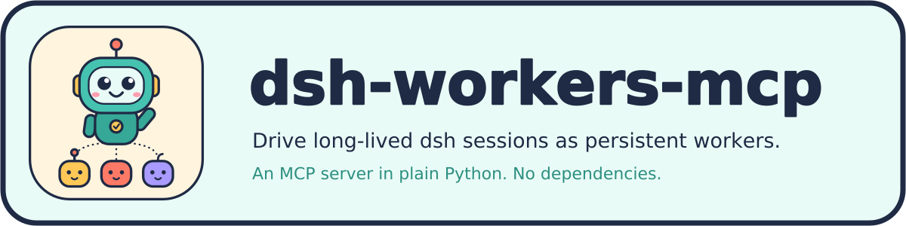

# dsh-workers-mcp



An MCP server that drives **long-lived [DeepSeek Harness](https://github.com/deepseek-ai/deepseek-harness) (`dsh`) sessions as persistent workers**. An orchestrating agent in any working directory uses it to dispatch work to the workers, answer the questions that block them, and inspect what they did.

The premise: a `dsh` worker session builds up orientation, and orientation is expensive. In the author's testing, a 57-turn session held about 13 hours of model time at a 97% cache-hit rate. That session is private, so you cannot reproduce the figure. To throw that away for each task is waste. These tools treat workers as teammates that you keep. They do not treat workers as functions that you call.

The runtime is **stdlib-only**. It has no dependencies, and that includes a WebSocket reader that we wrote by hand.

**New here?** Follow [`docs/QUICKSTART.md`](docs/QUICKSTART.md). It takes one worker through one task in about 15 minutes.

## What it is not

- **Not affiliated with DeepSeek.** This is an independent project. DeepSeek does not make, endorse or support it. It drives the open-source [DeepSeek Harness](https://github.com/deepseek-ai/deepseek-harness) through the HTTP API of that program.
- **Not an [A2A](https://a2a-protocol.org/) implementation.** It has no Agent Cards, no `SendMessage` operation and no Task lifecycle. We evaluated A2A and declined it on purpose: A2A treats an agent as opaque, and these tools show context pressure, cache-hit rates and step counts so that an orchestrator can supervise closely. [`docs/A2A_EVAL.md`](docs/A2A_EVAL.md) gives the reasoning.
- **Not general-purpose.** Every operation is specific to the HTTP API, the event types and the projections of `dsh`. It is not an abstraction over agent frameworks.

## Status

This is alpha (0.1.0). Tool names, tool arguments and the state format can change. The state format has a compatibility test against files from an older version.

**What ran**
- The tests run against a stand-in dsh, in CI on Python 3.10 to 3.13. CI also runs ruff, mypy, the complexity ratchet and the import-layer check.
- Read-only commands (`dshctl list`, `dshctl pending`, `host.describe`, the `dsh-wake` dry run and `dsh_list` over the MCP server) ran against a live dsh, package version `0.1.1-rc.2`, commit `b150a55`.
- The release v0.1.0 installs from its tag and from its wheel in a clean environment, and the server answers the MCP handshake. Nothing more was run from the installed copy.
- The original tools ran against a live dsh in a long project. The author did that testing. [`docs/DSH_API.md`](docs/DSH_API.md) says which.

**What did not run**
- The calls that change state (`dsh_create`, `dsh_fork`, `dsh_name`, `dsh_cancel`, `dsh_permission`, `dsh_task`, `dsh_ask`) ran against the stand-in only, since the client interface was added. The shape check does not cover them.
- The shape check covers 7 read-only methods. It does not cover stream frames or the two POST endpoints.
- The quick start ran end to end only with a scripted worker. No model ran, and no one else has followed it.
- `dsh-wake` has not run against a real client.
- The sandbox wrapper passes its self-test. A nested `bwrap` inside it does not start (see [`docs/SANDBOX.md`](docs/SANDBOX.md)). Two tests of the wrapper skip in CI, because bubblewrap is not usable on the runner. They pass on the author's machine.

If you find a difference between these notes and what you see, open an issue.

## Install

You need Python 3.10 or later and a running `dsh web` server (default `http://127.0.0.1:3080`).

**From a release.** The latest is [v0.1.0](https://github.com/EliasVahlberg/dsh-workers-mcp/releases/tag/v0.1.0). With [uv](https://docs.astral.sh/uv/), the MCP client can start the server straight from the tag. Put this in its configuration:

```json
{
  "mcpServers": {
    "dsh-workers": {
      "command": "uvx",
      "args": ["--from", "git+https://github.com/EliasVahlberg/dsh-workers-mcp@v0.1.0", "dsh-workers-mcp"],
      "timeout": 600000
    }
  }
}
```

Or download the wheel from the release page and run `uv tool install dsh_workers_mcp-0.1.0-py3-none-any.whl`. That puts `dsh-workers-mcp`, `dshctl` and `dsh-wake` on your path. We ran both ways in a clean environment, and the server answered the MCP handshake. The wheel holds the server and the `tool-policy` overlay only. The skill, the method and the templates are in the repository, so read them at the tag.

**From a clone.** Use this for development, or to read the method next to the code:

```bash
uv sync                 # or: pipx install -e .
```

There are three entry points:

| Command | Purpose |
|---|---|
| `dsh-workers-mcp` | the MCP stdio server |
| `dshctl` | the same operations as a CLI, useful for debugging |
| `dsh-wake` | optional loop that runs the client of the lead again when something needs it (see [`docs/WAKE.md`](docs/WAKE.md)) |

## Wiring it into an agent

With a release, use the `uvx` configuration from [Install](#install). With a clone, use this one:
```json
{
  "mcpServers": {
    "dsh-workers": {
      "command": "uv",
      "args": ["run", "--project", "/abs/path/to/dsh-workers-mcp", "dsh-workers-mcp"],
      "timeout": 600000
    }
  }
}
```

Use an absolute path. A relative path resolves against the working directory of the agent. That is the reason this server lives in its own repo.

Use `uv run --project`. Do not use `uv --directory`. The option `--directory` changes the working directory to this repo. That moves the default state directory here, and out of the workspace where the agent works.

The server flags:
- `--base <url>` sets the dsh server (default `http://127.0.0.1:3080`).
- `--state-dir <path>` sets where the server writes orchestrator state.
- `--no-state` records nothing and hides `dsh_roster`, `dsh_tasks`, `dsh_digest` and `dsh_brief`.
- `--allow-full-access` lets `dsh_permission` and `dsh_create` apply `danger-full-access`. The server refuses it by default.

The companion skill at [`skills/dsh-workers/SKILL.md`](skills/dsh-workers/SKILL.md) documents the protocol, the operational traps and the semantics of compaction. It is a plain markdown file with frontmatter. Load it with whatever your MCP-capable agent uses for skills or standing instructions. For example, kiro-cli references it as `skill:///abs/path/to/dsh-workers-mcp/skills/dsh-workers/SKILL.md`. A client without skills can include the file in its instructions.

## Workers and permissions

The method hires workers at a supervision level: `read-only`, `supervised` or `autonomous`. The `tool-policy` overlay in [`overlays/tool-policy/`](overlays/tool-policy/) provides them. They control **scope, not security**. Reads of any file in the home directory, the network, and writes into the area of another worker stay open. [`docs/PERMISSIONS.md`](docs/PERMISSIONS.md) has the presets and the full list of limits. [`docs/SANDBOX.md`](docs/SANDBOX.md) has an optional bubblewrap wrapper for the dsh server.

## The documents

| Read | For |
|---|---|
| [`docs/QUICKSTART.md`](docs/QUICKSTART.md) | one worker, one task, 15 minutes |
| [`docs/TOOLS.md`](docs/TOOLS.md) | the 21 tools, and which ones change worker state |
| [`orchestration/METHOD.md`](orchestration/METHOD.md) | the working method for a lead agent: session start, hiring, the task lifecycle, approvals, merge and release |
| [`orchestration/PLAYBOOKS.md`](orchestration/PLAYBOOKS.md) | the playbooks that the method points to: planning, dispatch, review, the size gate. `orchestration/templates/` has the files for each project |
| [`orchestration/REMINDER.md`](orchestration/REMINDER.md) | one page of the rules that matter most. Load it as a standing resource of the lead |
| [`docs/STATE.md`](docs/STATE.md) | the orchestrator state directory: roster, tasks, digest |
| [`docs/WAKE.md`](docs/WAKE.md) | `dsh-wake`, the loop that wakes the lead |
| [`docs/PERMISSIONS.md`](docs/PERMISSIONS.md) | the presets, and what a worker can and cannot do |
| [`docs/SANDBOX.md`](docs/SANDBOX.md) | the bubblewrap wrapper, and its known problem |
| [`docs/DSH_API.md`](docs/DSH_API.md) | what this package relies on in dsh, and what ran live |
| [`docs/DEVELOPMENT.md`](docs/DEVELOPMENT.md), [`CONTRIBUTING.md`](CONTRIBUTING.md) | the checks, the layers, how to add a tool |
| [`SECURITY.md`](SECURITY.md), [`CHANGELOG.md`](CHANGELOG.md) | how to report a problem, and what changed |

## License

MIT
